<p align="right"><a href="README.md">English</a> · <b>Español</b></p>

<p align="center">
  
</p>

<h1 align="center">SuperTube</h1>

<p align="center">
  <b>Un cliente de YouTube sin anuncios para móviles y tablets Android, con una interfaz táctil Material&nbsp;3.</b><br>
  También para Android TV. Fork de <a href="https://github.com/yuliskov/SmartTube">SmartTube</a> de yuliskov.<br>
  <a href="https://gestal.es/supertube/es/">gestal.es/supertube</a>
</p>

<p align="center">
  <a href="https://github.com/jgestal/SuperTube/releases/latest"></a>
  
  
  <a href="LICENSE"></a>
</p>

<p align="center">
  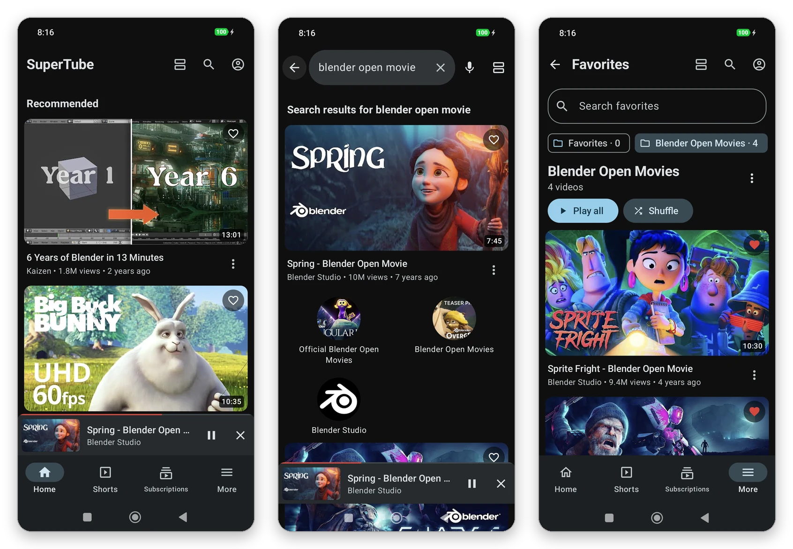
</p>

## Contenido

- [¿Por qué SuperTube?](#por-qué-supertube)
- [Funciones](#funciones)
- [SuperTube para Android TV](#supertube-para-android-tv)
- [Instalación](#instalación)
- [Preguntas frecuentes](#preguntas-frecuentes)
- [Privacidad](#privacidad)
- [Compilar el código](#compilar-el-código)
- [Arquitectura](#arquitectura)
- [Cómo contribuir](#cómo-contribuir)
- [Aviso legal](#aviso-legal)
- [Créditos y licencia](#créditos-y-licencia)

## ¿Por qué SuperTube?

[SmartTube](https://github.com/yuliskov/SmartTube) es un cliente de YouTube excelente, pero está hecho para el mando de
la tele: una interfaz fija a 1080p pensada para verse desde el sofá, navegación por foco con la cruceta y pantallas
Leanback. En un móvil todo se ve diminuto y es incómodo de usar con los dedos.

**SuperTube conserva el motor de SmartTube** (sin anuncios, SponsorBlock, DeArrow, cuentas, historial, listas, elección
de calidad y códec) y **sustituye toda la interfaz** por una diseñada para pantallas táctiles, siguiendo las
[guías de diseño adaptativo de Android](https://developer.android.com/develop/ui/compose/layouts/adaptive).

## Funciones

### Una interfaz móvil de verdad

Jetpack Compose y Material 3, con tema claro y oscuro y colores dinámicos. La navegación se adapta a la ventana: barra
inferior en el móvil y barra lateral en horizontal, en tablets y en plegables. Los vídeos se pueden ver en **lista**,
**lista compacta**, **cuadrícula** o **carruseles horizontales**, y la app recuerda tu elección.

<p align="center">
  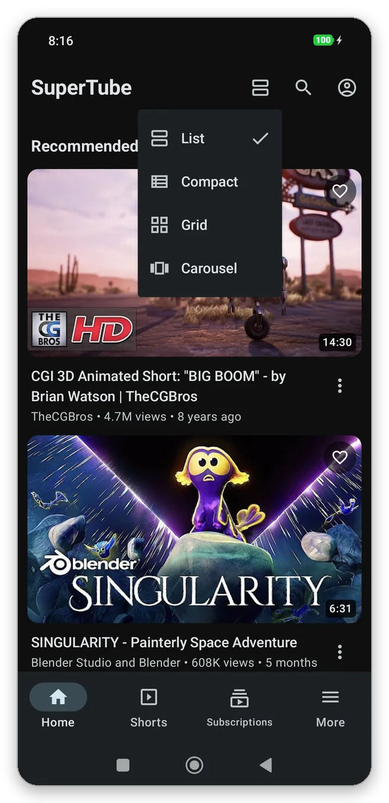
  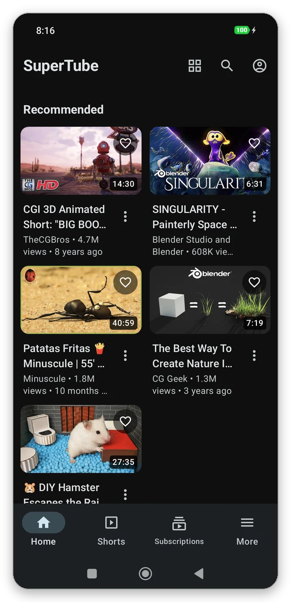
</p>
<p align="center">
  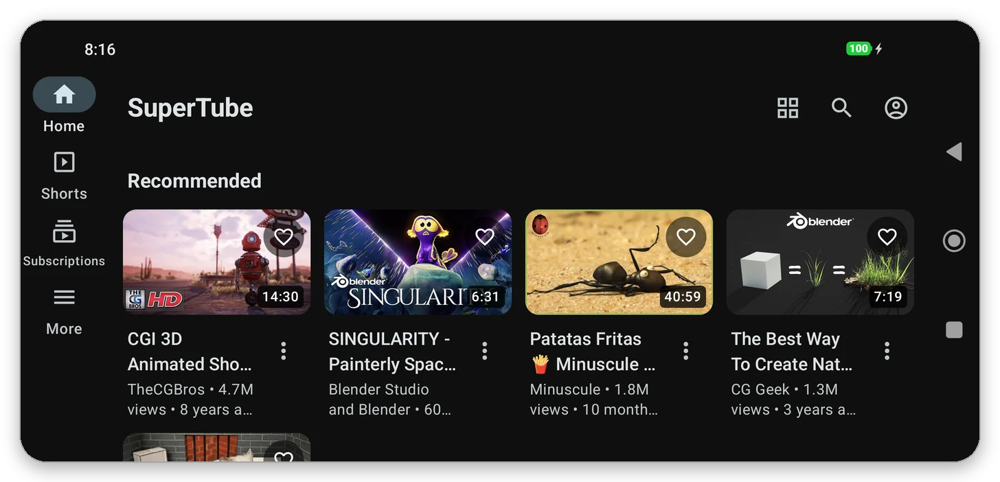
</p>

### Reproductor táctil

| Gesto o control | Acción |
| --- | --- |
| Doble toque a la izquierda / derecha | Retrocede / avanza 10 s (los toques seguidos se suman) |
| Mantener pulsado | Velocidad 2× mientras se mantiene |
| Botón de velocidad | 1× → 1,5× → 2×; pulsación larga para la lista completa |
| Deslizar arriba / abajo | Pantalla completa / pasar al mini reproductor (los vídeos verticales siguen en vertical) |
| Deslizar en pantalla completa | Brillo (lado izquierdo) y volumen (lado derecho) |

La barra de progreso muestra los segmentos de **SponsorBlock**. Atrás o deslizar hacia abajo convierte el vídeo en un
**mini reproductor** que sigue sonando mientras navegas. Al salir de la app el vídeo sigue en **imagen en imagen**, y el
audio continúa con la pantalla apagada, con **controles en la pantalla de bloqueo y en las notificaciones**. También hay
**temporizador de apagado**, y la reproducción se pausa al desconectar los auriculares.

<p align="center">
  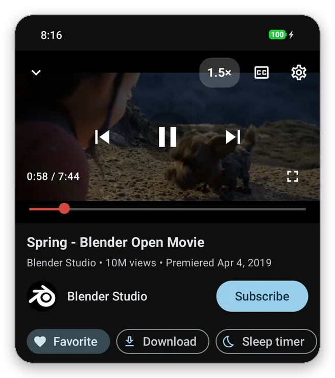
  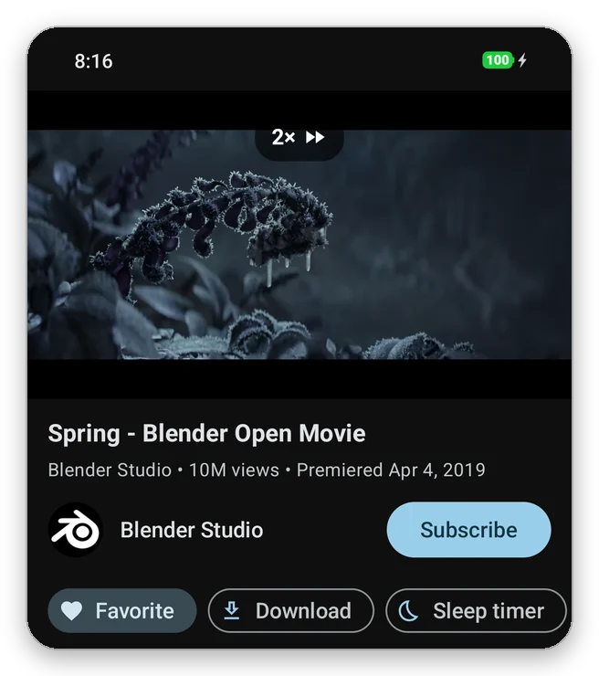
</p>
<p align="center">
  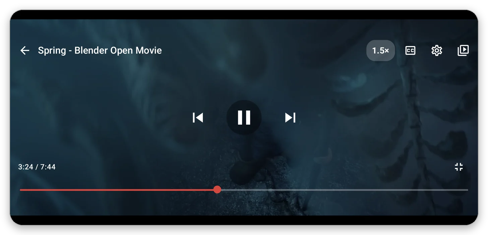
</p>
<p align="center">
  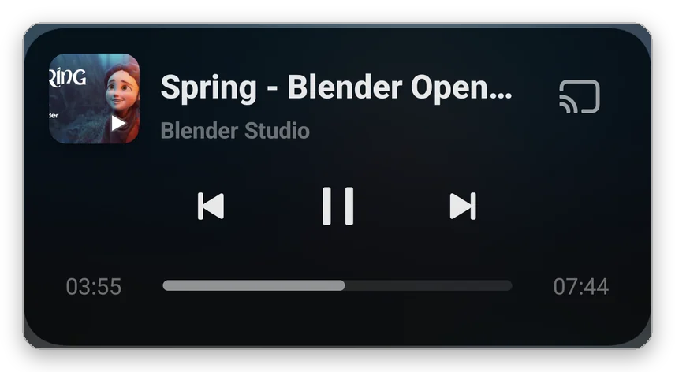
</p>

### Favoritos con carpetas

El ♡ de cada vídeo lo guarda en *Favoritos* o en tus propias carpetas. Las carpetas se pueden buscar, renombrar y
reproducir en orden o en aleatorio. Un **widget de pantalla de inicio** las muestra, y todo se puede **exportar e
importar** en un archivo JSON. Los favoritos se guardan solo en tu dispositivo.

<p align="center">
  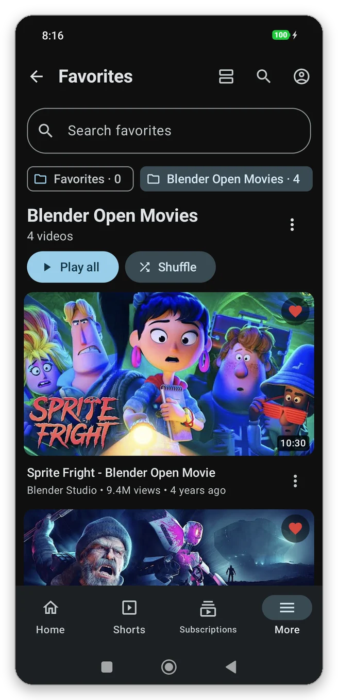
  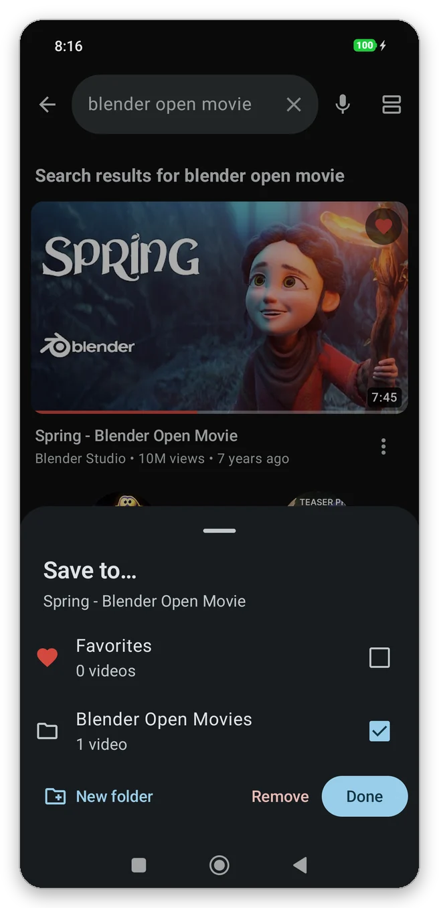
  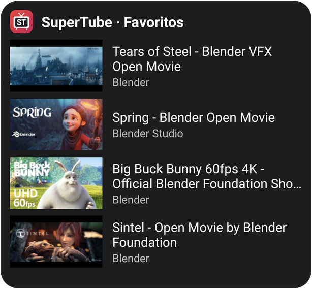
</p>

### Gestor de descargas

Descarga el **audio** o el **vídeo** (hasta 1080p H.264, unido en el dispositivo sin recodificar) eligiendo la calidad y
viendo su tamaño. Las descargas se pueden **pausar y reanudar**, incluso después de cerrar la app, y los enlaces
caducados se renuevan solos. Tiene modo **solo Wi‑Fi** opcional, filtros de vídeo y audio y un reproductor sin conexión.
Los archivos se guardan en `Movies/SuperTube` y `Music/SuperTube`.

<p align="center">
  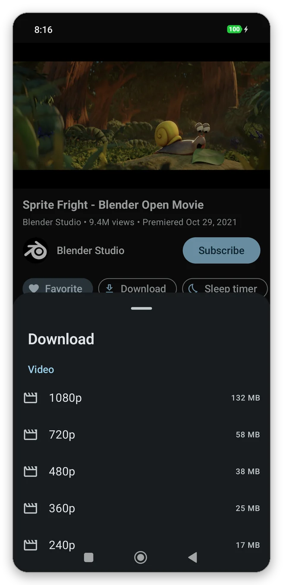
  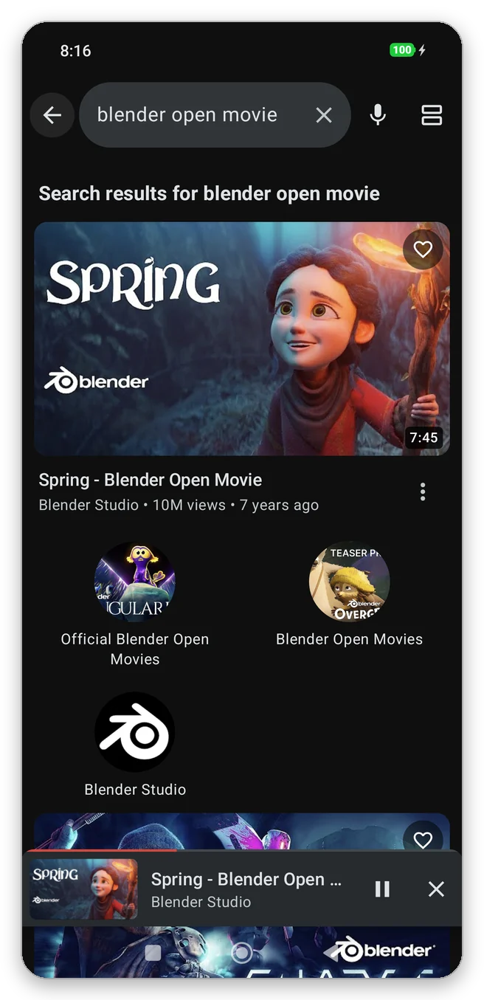
</p>

> [!NOTE]
> Sin cuenta de YouTube, YouTube solo ofrece vídeos en un único archivo (normalmente 360p). Inicia sesión para
> descargar hasta 1080p.

### Y además

- **Búsqueda** con búsquedas recientes guardadas en el dispositivo, búsqueda por voz y filtros.
- **Secciones reordenables** en *Más*, ajustes en hojas inferiores y los ajustes exclusivos de TV ocultos.
- **Abre los enlaces de YouTube** compartidos o pulsados en otras apps. En Android 12+ hay que permitirlo una vez en
  *Ajustes › SuperTube › Abrir enlaces de YouTube*, que explica los pasos. Si tienes instalada la app de YouTube, se
  queda con los enlaces hasta que desactives su opción *Abrir enlaces compatibles*.
- **Actualizaciones** desde las releases de este repositorio (*Ajustes › SuperTube › Buscar actualizaciones*).
- **20 idiomas**, que se pueden elegir por app en los ajustes del sistema de Android 13+.
- Todo lo de SmartTube: sin anuncios, SponsorBlock, DeArrow, inicio de sesión (suscripciones, historial, listas),
  4K/8K, HDR, 60 fps, elección de códec, subtítulos, chat en directo y comentarios.

## SuperTube para Android TV

La app de TV (módulo `smarttubetv`) mantiene la interfaz Leanback de SmartTube, pensada para el mando, y añade:

- **Imágenes de fondo**: el vídeo seleccionado ocupa el fondo, al estilo Netflix, difuminado para que el texto se lea
  bien. Si no hay miniatura, la pantalla de inicio muestra una imagen ambiental de SuperTube.
- **Modo ligero para teles y TV boxes lentos** (*Ajustes › Interfaz de usuario*): sin imágenes de fondo, vistas previas
  en las tarjetas, títulos en movimiento ni miniaturas al avanzar, y con un búfer de vídeo más pequeño.
- Nombre, iconos, banner del lanzador y canal de la pantalla de inicio de SuperTube, y actualizaciones desde este
  repositorio (*Ajustes › Acerca de › Buscar actualizaciones*).

<p align="center">
  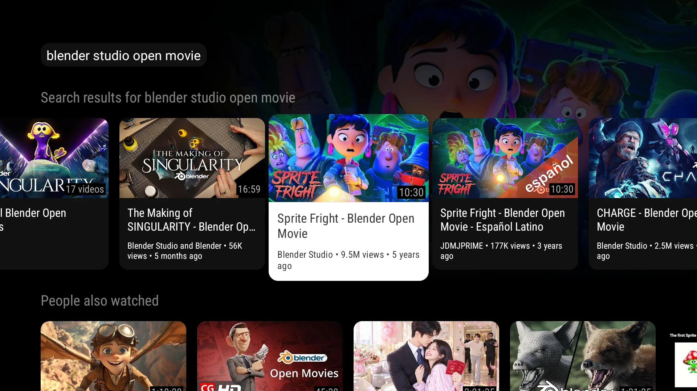
</p>
<p align="center">
  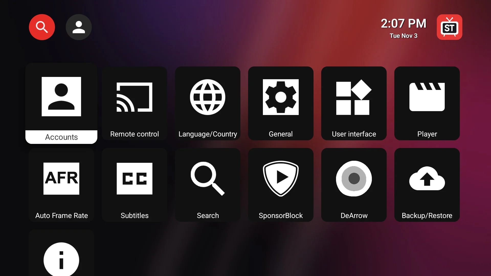
  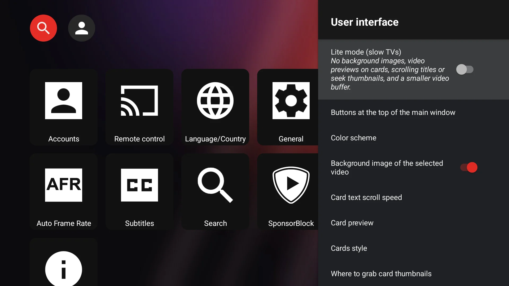
</p>

## Instalación

Descarga el APK de la **[última release](https://github.com/jgestal/SuperTube/releases/latest)** o de
[gestal.es/supertube](https://gestal.es/supertube/es/). En la tele, abre **gestal.es/supertube/tv** en el navegador o en
una app de descargas.

| Dispositivo | Archivo | Paquete |
| --- | --- | --- |
| Móvil o tablet | `SuperTube-<versión>.apk` | `es.gestal.supertube` |
| Android TV (cualquiera) | `SuperTubeTV_stable_<versión>_universal.apk` | `es.gestal.supertube.tv` |
| Android TV (descarga más pequeña) | `…_arm64-v8a.apk` para teles recientes, `…_armeabi-v7a.apk` para las antiguas, `…_x86.apk` | `es.gestal.supertube.tv` |

**Requisitos:** Android 8.0 o superior. Preparada para dispositivos con páginas de memoria de 16 KB. SuperTube es una
app independiente y se puede instalar junto a SmartTube.

**Actualizaciones:** una vez instalada, las nuevas versiones se instalan desde *Buscar actualizaciones* en los ajustes
de la app. Los cambios de cada versión están en el [changelog](CHANGELOG.md) (en inglés).

### Avisos al instalar

Android avisa de todas las apps que no vienen de Google Play. Estos son los mensajes habituales y qué pulsar:

| Dónde | Mensaje | Qué hacer |
| --- | --- | --- |
| Chrome | «Este tipo de archivo puede dañar tu dispositivo» | Pulsa **Descargar de todos modos** |
| Android | «Por seguridad, tu teléfono no puede instalar aplicaciones desconocidas de esta fuente» | Pulsa **Ajustes**, activa **Permitir desde esta fuente** y vuelve atrás |
| Play Protect | «Aplicación no segura bloqueada» o «Aplicación desconocida» | Pulsa **Más detalles** y luego **Instalar de todos modos** (en la tele, lo mismo con el mando) |
| Play Protect | Más tarde desactiva o elimina la app | Play Store › tu perfil › **Play Protect** › ajustes › desactiva **Analizar aplicaciones con Play Protect** e instálala de nuevo |

### Comprobar el APK

Todas las releases se firman con el mismo certificado y se analizan con VirusTotal (el informe está en las notas de la
release). Para comprobar que un APK es el original, compara su certificado de firma:

```bash
apksigner verify --print-certs SuperTube-<versión>.apk   # incluido en las build-tools del Android SDK
```

El resumen SHA-256 debe ser:

```
f6:fb:28:69:7f:24:d1:bf:21:ff:12:b8:20:e2:64:ca:4a:94:2f:3e:e8:4c:75:f2:01:6d:eb:3c:e6:07:70:41
```

(`apksigner` lo muestra sin los dos puntos.)

## Preguntas frecuentes

<details>
<summary><b>¿Es gratis?</b></summary>

Sí. Sin anuncios, sin suscripciones y sin compras dentro de la app. El código está en este repositorio con licencia MIT.
</details>

<details>
<summary><b>¿Es una app oficial de YouTube?</b></summary>

No. SuperTube es un proyecto independiente, sin relación con Google ni con YouTube. Está basado en SmartTube, un cliente
de código abierto.
</details>

<details>
<summary><b>¿Por qué no está en Google Play?</b></summary>

Google Play no acepta apps como esta, así que se publica como APK en las releases de GitHub y en la web, con el
certificado de firma indicado más arriba.
</details>

<details>
<summary><b>¿Necesito una cuenta?</b></summary>

No. Inicia sesión solo si quieres tus suscripciones, historial y listas, o descargas por encima de 360p. La sesión se
guarda en tu dispositivo.
</details>

<details>
<summary><b>¿Funciona con Chromecast o Android Auto?</b></summary>

No. SuperTube no incluye los servicios de Google Play, que esas funciones necesitan.
</details>

<details>
<summary><b>¿Hay versión para iPhone?</b></summary>

No. SuperTube es para Android 8.0 o superior, en móviles, tablets y Android TV.
</details>

<details>
<summary><b>¿Puedo usar el APK del móvil en la tele, o al revés?</b></summary>

Se instala, pero el APK del móvil no está hecho para el mando y el de la tele no está hecho para pantallas táctiles.
</details>

Más respuestas en las [preguntas frecuentes de la web](https://gestal.es/supertube/es/#faq).

## Privacidad

SuperTube no recoge ningún dato personal para el desarrollador: no hay cuentas de SuperTube, ni analíticas, ni
publicidad, ni informes de errores, ni un servidor propio. Los ajustes, favoritos, búsquedas recientes, descargas y la
sesión opcional de Google se quedan en tu dispositivo. Para funcionar, la app se conecta directamente a YouTube/Google,
SponsorBlock, DeArrow, Return YouTube Dislike y GitHub (comprobación de actualizaciones).

Lee la [política de privacidad](PRIVACY.es.md) completa, también publicada en
[gestal.es/supertube/es/privacy](https://gestal.es/supertube/es/privacy/).

## Compilar el código

**Requisitos:** JDK 17 (Gradle 7.5 funciona con JDK 11–17), el Android SDK y los submódulos de git.

```bash
git clone --recurse-submodules https://github.com/jgestal/SuperTube.git
cd SuperTube

# App para móvil y tablet → supertube/build/outputs/apk/stbeta/debug/
JAVA_HOME=/ruta/al/jdk-17 ./gradlew :supertube:assembleStbetaDebug

# App para Android TV → smarttubetv/build/outputs/apk/ststable/debug/
JAVA_HOME=/ruta/al/jdk-17 ./gradlew :smarttubetv:assembleStstableDebug
```

Si clonaste sin `--recurse-submodules`, ejecuta `git submodule update --init --recursive`.

### Tests

```bash
./gradlew :supertube:testStbetaDebugUnitTest :supertube:lintStbetaDebug   # tests unitarios y lint
supertube/tools/rotation_e2e.sh ruta/a/SuperTube.apk                       # pantalla completa y rotación, en un emulador
```

Cada push a `main` compila los APK en GitHub Actions (lint, compilación y análisis de VirusTotal); los APK nightly
quedan disponibles como artefactos del workflow.

### Versiones firmadas y releases

Para compilar versiones firmadas, crea `supertube/keystore.properties` (app del móvil) y `keystore.properties` en la
raíz del repositorio (app de TV), ambos con `storeFile`, `storePassword`, `keyAlias` y `keyPassword`. Después ejecuta
`./gradlew :supertube:assembleStbetaRelease`.

Para publicar una versión, pon el mismo `versionName` en las dos apps, añade una sección con fecha al
[changelog](CHANGELOG.md) y ejecuta `tools/release/release.sh`. El script pasa los tests, compila y comprueba las dos
apps firmadas, escribe el manifiesto de actualización de la TV, crea la release de GitHub con todos los APK y regenera la
web. `--dry-run` se detiene después de compilar.

Los APK firmados se quedan en `dist/` (fuera de git) y la web aloja los más recientes en `landing/apk/`. Después de cada
release, sube `landing/` y renombra `_htaccess` a `.htaccess` en el servidor (consulta
[landing/server/](landing/server/README.md) para Apache y nginx).

### Web e imágenes promocionales

La web (`landing/`, 6 idiomas) y las imágenes para redes sociales (`promo/`) se generan con:

```bash
python3 tools/landing/gen_landing.py
python3 tools/landing/promo.py
```

## Arquitectura

SuperTube reutiliza la arquitectura MVP de SmartTube: cada presenter del módulo `common` habla con una interfaz `View`
(`BrowseView`, `PlaybackView`, `SearchView`, `AppDialogView`…). La app de TV implementa esas vistas con fragments
Leanback; **SuperTube las implementa con actividades Compose**, así que la lógica de negocio se comparte sin cambios.

| Módulo | Descripción |
| --- | --- |
| `supertube` | La app móvil: interfaz Compose, servicio de reproducción, favoritos, descargas, widget, actualizador |
| `common` | Lógica de negocio de SmartTube: presenters, motor del reproductor (ExoPlayer), ajustes |
| `smarttubetv` | La app de Android TV (interfaz Leanback, imágenes de fondo, modo ligero); mantiene el nombre del módulo para integrar los cambios de upstream |
| `MediaServiceCore`, `SharedModules` | Submódulos de SmartTube (API de YouTube, utilidades) |
| `landing`, `promo`, `tools` | Web, imágenes promocionales y scripts de release y de generación |

Partes destacadas exclusivas del móvil en `supertube/src/main/java/.../mobile/`:

| Ruta | Función |
| --- | --- |
| `ui/playback/` | Pantalla del reproductor, controles, gestos y mini reproductor |
| `playback/` | Sesión multimedia, notificación y servicio en primer plano `mediaPlayback` |
| `ui/feed/` | Vistas de vídeos compartidas por todas las pantallas |
| `download/` | Descargas reanudables, unión de pistas y modo solo Wi‑Fi |
| `prefs/`, `widget/`, `update/` | Favoritos y ajustes, widget de pantalla de inicio, actualizador |

## Cómo contribuir

- **Errores e ideas:** abre una [incidencia](https://github.com/jgestal/SuperTube/issues/new/choose) con la plantilla de
  error o de petición de función. Antes, revisa las [preguntas frecuentes](https://gestal.es/supertube/es/#faq) y las
  incidencias existentes, e indica la versión de la app, el dispositivo y la versión de Android.
- **Pull requests:** que cada una se centre en un solo cambio, y pasa los tests unitarios y el lint antes de abrirla. Los
  problemas del motor de YouTube (vídeos que no cargan, inicio de sesión) suelen corresponder a
  [SmartTube](https://github.com/yuliskov/SmartTube) o [MediaServiceCore](https://github.com/yuliskov/MediaServiceCore).
- **Traducciones:** cada texto nuevo debe añadirse a los 20 archivos `strings.xml`.

## Aviso legal

Las condiciones de servicio de YouTube no permiten clientes de terceros ni bloquear anuncios. Descargar contenido puede
infringir los derechos de autor, salvo que tengas los derechos o que la ley de tu país lo permita. La función de
descarga está pensada para el **uso personal** de contenido que puedas guardar, como las películas Creative Commons de
la Blender Foundation que aparecen en las capturas. No redistribuyas contenido protegido. Cómo uses la app es tu
decisión y tu responsabilidad.

SuperTube no está afiliado, respaldado ni relacionado con YouTube, Google ni el proyecto SmartTube. YouTube, Android y
Google TV son marcas registradas de Google LLC.

## Créditos y licencia

SuperTube está basado en **[SmartTube](https://github.com/yuliskov/SmartTube)** de **yuliskov** y en sus módulos
[MediaServiceCore](https://github.com/yuliskov/MediaServiceCore) y [SharedModules](https://github.com/yuliskov/SharedModules),
publicados con licencia MIT. Todo el mérito del motor de YouTube y de las funciones originales es suyo.

SuperTube se publica con [licencia MIT](LICENSE) © 2026 Juan Gestal. ExoPlayer (`exoplayer-amzn-2.10.6`) tiene licencia
Apache 2.0. El motor de YouTube de `MediaServiceCore` usa [Java Regex](https://github.com/florianingerl/com.florianingerl.util.regex)
de Florian Ingerl, con licencia GPL 2.0; su código está disponible en ese enlace. Las capturas muestran películas
Creative Commons de la Blender Foundation, sin una cuenta iniciada.

Contacto: [juan@gestal.es](mailto:juan@gestal.es)
