<p align="center">
  
</p>

<h1 align="center">SuperTube</h1>

<p align="center">
  <b>An ad-free YouTube client for Android phones and tablets, with a touch-first Material&nbsp;3 interface.</b><br>
  Phone &amp; tablet fork of <a href="https://github.com/yuliskov/SmartTube">SmartTube</a> by yuliskov.
</p>

<p align="center">
  <a href="https://github.com/jgestal/SuperTube/releases/latest"></a>
  
  
  <a href="LICENSE"></a>
</p>

<p align="center">
  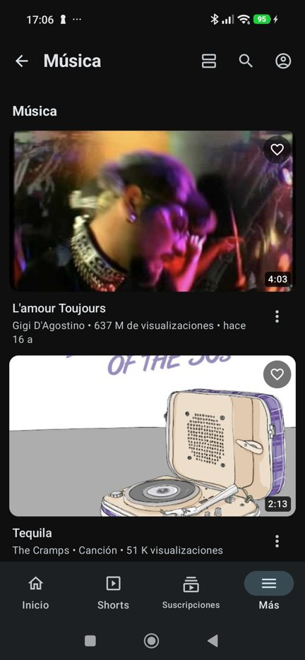
  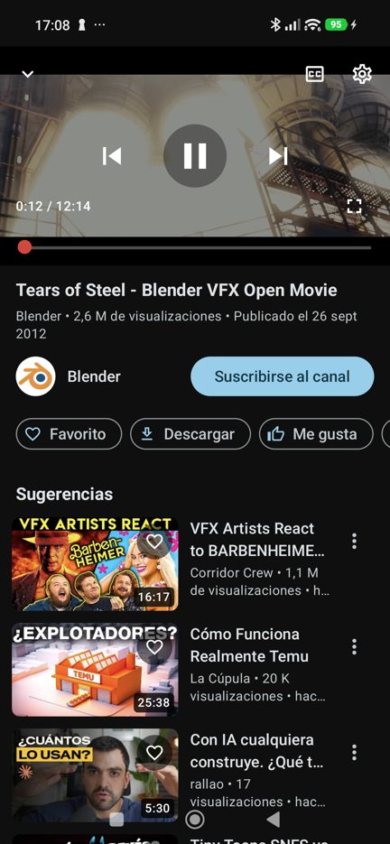
  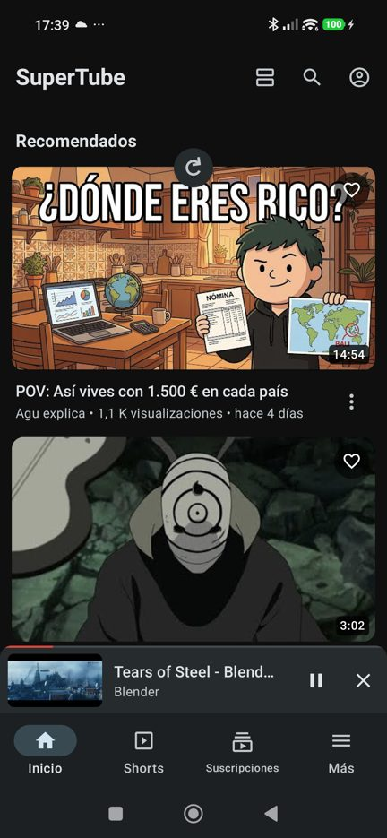
  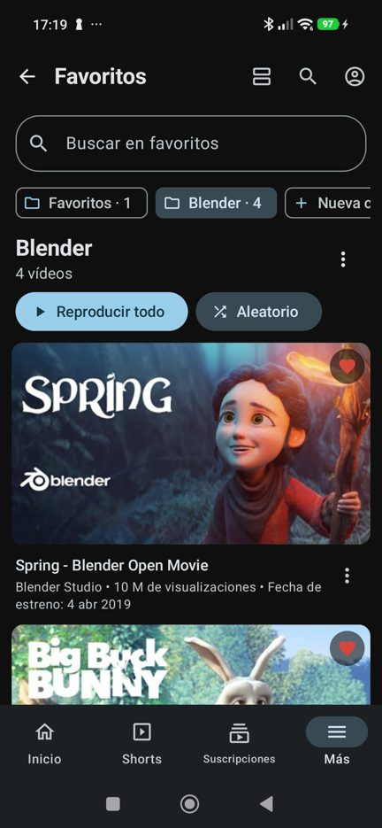
  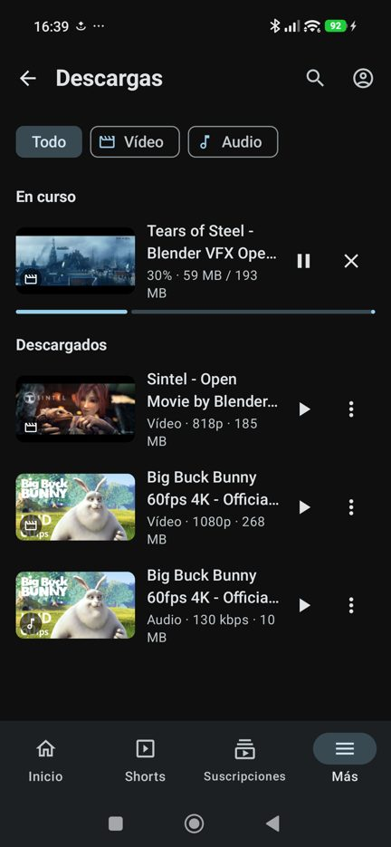
</p>

---

## Why SuperTube?

[SmartTube](https://github.com/yuliskov/SmartTube) is an excellent YouTube client, but it is built for **TV remotes**:
a fixed 1080p "10-foot" interface, D-pad focus navigation and Leanback screens. On a phone it looks tiny, wastes space
and is awkward to use with your fingers.

**SuperTube keeps SmartTube's engine** (no ads, SponsorBlock, DeArrow, accounts, history, playlists, quality and
codec selection, background playback…) and **replaces the whole interface** with one designed for touch screens,
following the official [Android adaptive design guidelines](https://github.com/android/skills).

## What's new in 1.1

| | |
|---|---|
| 🎵 **Mini player** | Back or swipe down collapses the video into a bar while you keep browsing; tap to expand, ✕ to stop. |
| 🌙 **Sleep timer** | 15 / 30 / 45 / 60 / 90 minutes or at the end of the video. |
| ⬇️ **Quality picker** | Choose the video resolution or audio bitrate (with sizes) before downloading. |
| 📶 **Wi‑Fi only downloads** | Downloads wait for Wi‑Fi and resume automatically; a running one goes back to the queue on mobile data. |
| 🏠 **Home screen widget** | Your favorites on the home screen: tap to play, tap the header to open them in the app. |
| 💾 **Export / import** | Back up favorites and SuperTube settings to a JSON file and restore them on any device. |
| 🔄 **Updates from this repo** | SuperTube checks its own GitHub releases, shows the notes and installs the new APK. The upstream SmartTube updater is disabled. |
| 🛠️ **Fixes** | Audio downloads without an account, real file sizes, private empty search (only your local recent searches), app no longer sent to the background after closing a player opened from a link. |

## Features

### 📱 A real mobile interface
- **Jetpack Compose + Material 3**, light/dark themes and dynamic colors (Android 12+).
- **Adaptive navigation**: bottom bar on phones, **navigation rail** in landscape, on tablets and foldables.
- **Four feed layouts**, switchable from the top bar and remembered:
  **List** (YouTube-app style, default) · **Compact** (more videos per screen) · **Grid** (two columns) · **Carousel** (horizontal shelves).
- Grids that add columns on wider screens, edge-to-edge drawing, native screen density.
- Top bar that hides while scrolling; **tap the current tab again** to scroll to the top (or refresh).

| Layout menu | List | Compact | Grid | Carousel |
|:---:|:---:|:---:|:---:|:---:|
| 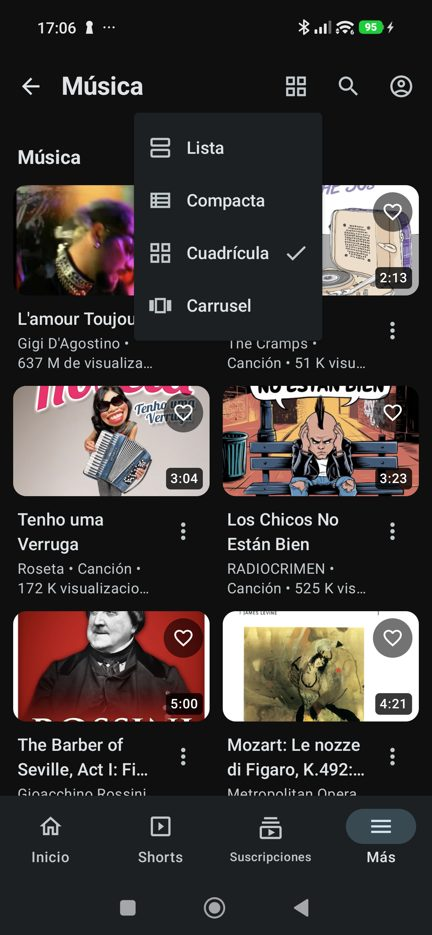 |  | 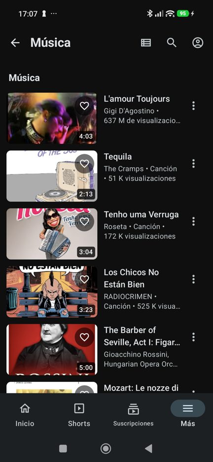 | 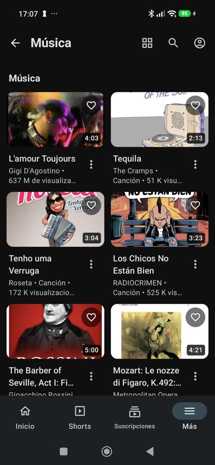 | 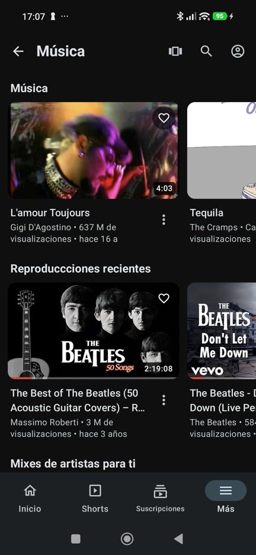 |

<p align="center">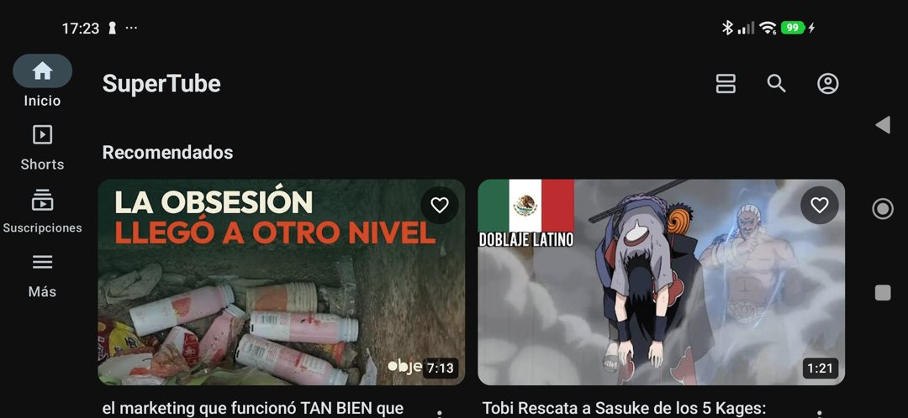</p>

### ▶️ Touch player
- **Double tap** left/right to seek ±10 s (consecutive taps add up), with on-screen feedback.
- **Press and hold** for 2× speed, like the YouTube app.
- **Swipe** up for fullscreen / down to collapse into the **mini player**; in fullscreen, swipe the **left side for brightness** and the **right side for volume**.
- Rotate to go fullscreen (immersive), thin seek bar with **SponsorBlock segments**, picture-in-picture, keeps the screen on while playing.
- Action chips: favorite, download, sleep timer, like, comments, share, save to playlist, speed, repeat, PiP, queue.

| Player | Double tap | Hold for 2× | Mini player | Sleep timer |
|:---:|:---:|:---:|:---:|:---:|
|  | 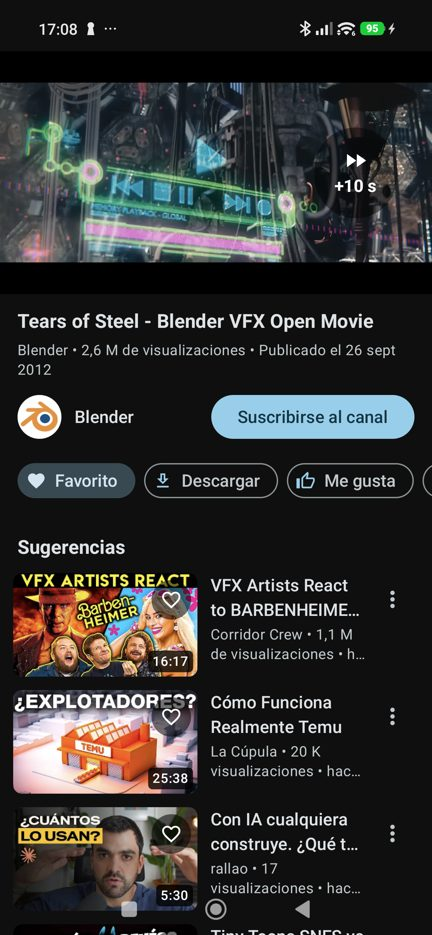 | 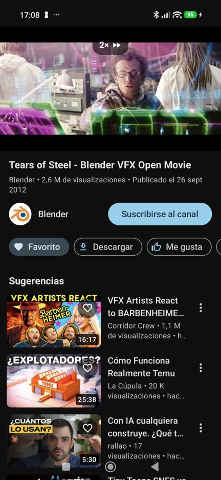 | 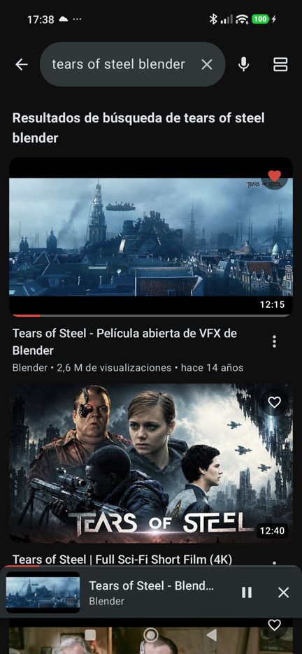 | 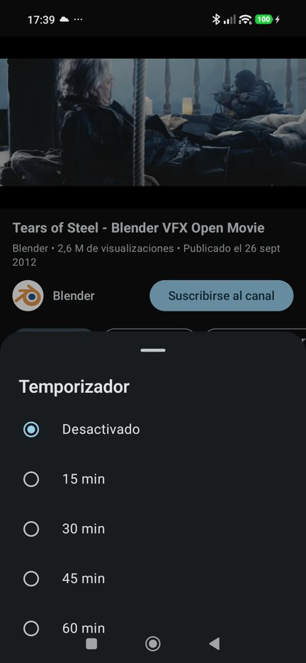 |

<p align="center">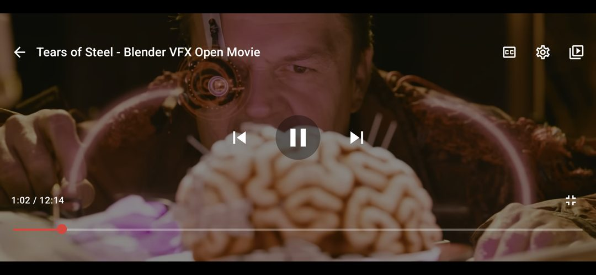</p>

### ❤️ Favorites with folders
- A ♡ button on every video opens a **"Save to…"** sheet: the general *Favorites* folder plus your own folders, and a quick **Remove**.
- **Search** across all your favorites, create, rename or delete folders.
- **Play all** or **shuffle** a folder as a continuous queue.
- **Home screen widget**, **export/import** to a JSON file. Stored only on your device.

| Folder | Search | Save to… |
|:---:|:---:|:---:|
|  | 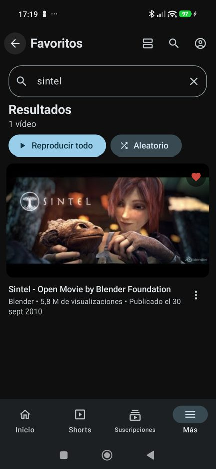 | 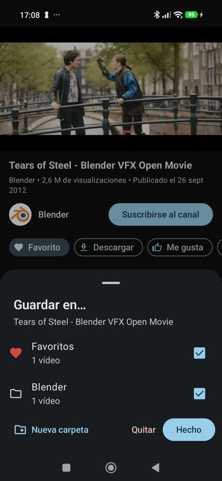 |

### ⬇️ Downloads manager
- Download the **audio** or the **video** (up to 1080p H.264, audio and video joined on the device, no re-encoding), choosing the **quality** and seeing the size first.
- **Pause, resume and cancel**: transfers continue where they stopped, even after closing the app; expired links are refreshed automatically.
- **Wi‑Fi only** mode, filters by **video / audio**, offline player, share or delete files.
- Detects files that were **moved or deleted** outside the app and offers to download them again.
- A **floating indicator** shows the progress from any screen; tap it to open the manager.
- Files are saved in `Movies/SuperTube` and `Music/SuperTube`.

| Quality picker | In progress | Paused | Downloaded |
|:---:|:---:|:---:|:---:|
| 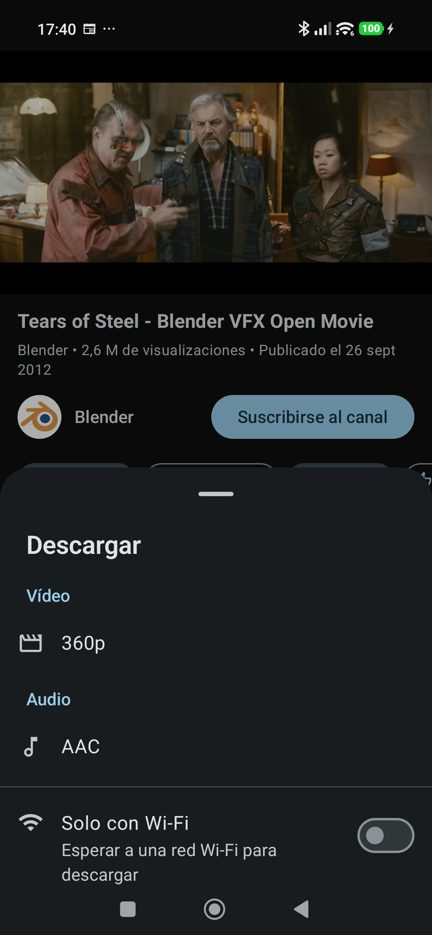 |  | 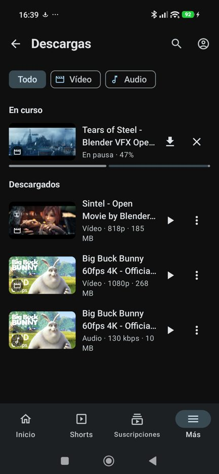 | 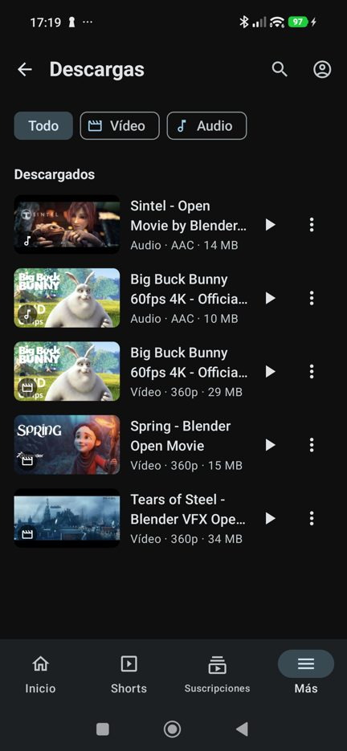 |

> Without a YouTube account, YouTube only offers single-file streams (usually 360p); sign in for up to 1080p.

### 🔎 Search, navigation and settings
- **Recent searches** stored locally (YouTube suggestions appear while typing), voice search, filters, hardware keyboard Enter.
- The **"More" sections can be reordered** by dragging them or with up/down buttons (news, music and channels first by default).
- Menus and settings as **bottom sheets**; TV-only settings are hidden; a **SuperTube** settings block for updates and backups.

| Search | Recent searches | Reorder sections | Settings | Player settings |
|:---:|:---:|:---:|:---:|:---:|
| 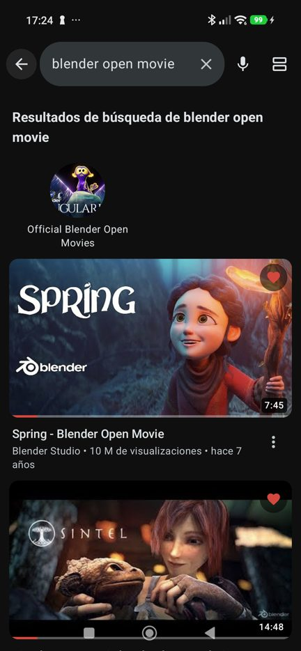 | 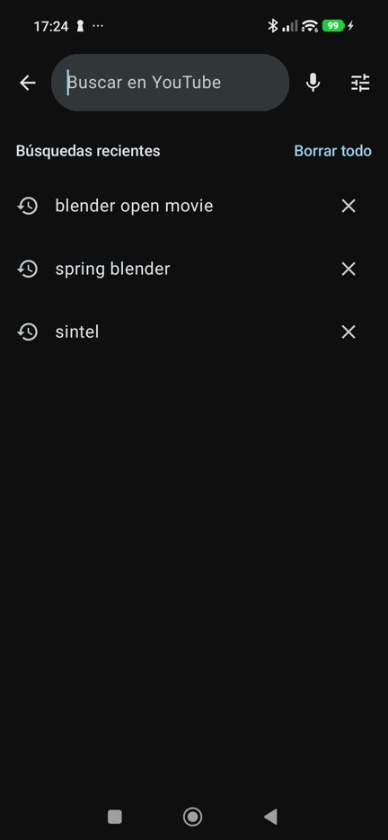 | 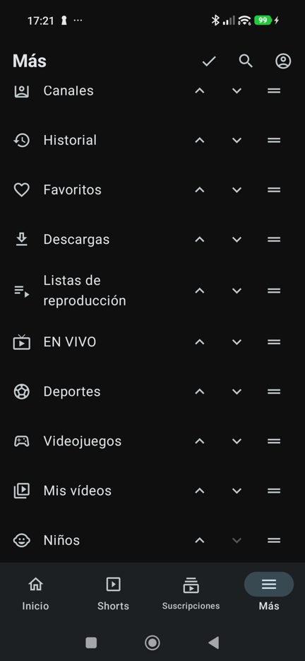 | 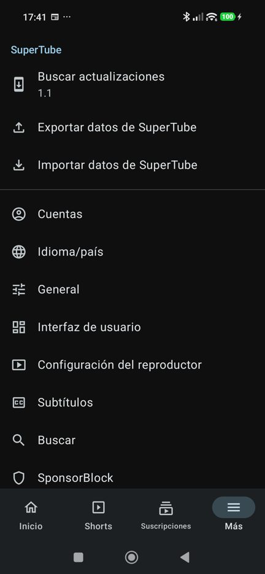 | 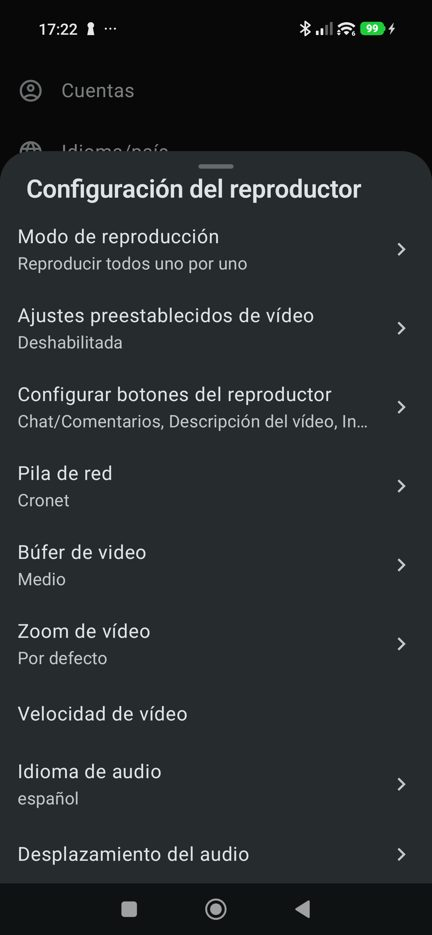 |

### 📺 Everything from SmartTube
No ads · SponsorBlock · DeArrow · sign in with your account (subscriptions, history, playlists) · 4K/8K, HDR, 60 fps and
codec selection · background playback · playback speed · subtitles · live chat and comments · channels and playlists.

## Download

Get the latest APK from the **[Releases page](https://github.com/jgestal/SuperTube/releases/latest)** and install it
(you may need to allow installing apps from your browser or file manager). Next versions can be installed from
**Settings › SuperTube › Check for updates**.

- Requires **Android 8.0** or newer (ARM 32/64-bit).
- SuperTube is a separate app (`app.supertube`): it can be installed next to SmartTube.
- Release signing certificate (SHA-256):
  `f6:fb:28:69:7f:24:d1:bf:21:ff:12:b8:20:e2:64:ca:4a:94:2f:3e:e8:4c:75:f2:01:6d:eb:3c:e6:07:70:41`

SuperTube is distributed only through GitHub (not Google Play), so it doesn't include Google Play Services
features such as Chromecast or Android Auto.

## Building

```bash
git clone --recurse-submodules https://github.com/jgestal/SuperTube.git
cd SuperTube
# Gradle 7.5 runs on JDK 11-17
JAVA_HOME=/path/to/jdk-17 ./gradlew :supertube:assembleStbetaDebug
```

The APK is generated in `supertube/build/outputs/apk/stbeta/debug/`. For signed release builds create
`supertube/keystore.properties` (`storeFile`, `storePassword`, `keyAlias`, `keyPassword`) and run
`./gradlew :supertube:assembleStbetaRelease`.

## Architecture

SuperTube reuses SmartTube's MVP architecture: every presenter in the `common` module talks to a `View` interface
(`BrowseView`, `PlaybackView`, `SearchView`, `AppDialogView`…). The TV app implements those views with Leanback
fragments; **SuperTube implements them with Compose activities**, so all the business logic is shared unchanged.

| Module | Description |
| --- | --- |
| `supertube` | The mobile app: Compose UI, favorites, downloads manager, widget, updater, preferences |
| `common` | SmartTube business logic: presenters, player engine (ExoPlayer), settings |
| `smarttubetv` | Original SmartTube TV app (kept to make merging upstream changes easy) |
| `MediaServiceCore`, `SharedModules` | SmartTube submodules (YouTube API, utilities) |

Notable mobile-only pieces: `ui/feed/FeedView.kt` (layouts), `ui/playback/PlayerGestures.kt`, `ui/playback/MiniPlayerBar.kt`,
`download/DownloadService.kt` (resumable downloads, track joining, Wi‑Fi only), `prefs/FavoritesStore.kt`,
`widget/FavoritesWidgetProvider.kt`, `update/UpdateChecker.kt`.

## Downloads notice

Downloading content may be against YouTube's Terms of Service. The download feature is provided for **personal use**
of content you have the right to save (for example Creative Commons videos like the Blender open movies shown above).
Do not redistribute copyrighted content.

## Credits and license

SuperTube is based on **[SmartTube](https://github.com/yuliskov/SmartTube)** by **yuliskov** and its modules
[MediaServiceCore](https://github.com/yuliskov/MediaServiceCore) and [SharedModules](https://github.com/yuliskov/SharedModules),
released under the MIT License. All the credit for the YouTube engine and the original features goes to them.
The original README is kept in [README_SmartTube.md](README_SmartTube.md).

SuperTube is released under the [MIT License](LICENSE). ExoPlayer (`exoplayer-amzn-2.10.6`) is licensed under Apache 2.0.
Screenshots show Creative Commons content by the Blender Foundation and public YouTube music charts (no account signed in).

SuperTube is not affiliated with, endorsed by or connected to YouTube, Google or the SmartTube project.

---

<details>
<summary><b>🇪🇸 En español</b></summary>

**SuperTube** es un cliente de YouTube sin anuncios para móviles y tablets Android, basado en SmartTube (diseñado para
TV). Mantiene todo su motor y sustituye la interfaz por una táctil con Material 3:

- Navegación adaptativa (barra inferior / barra lateral) y cuatro vistas de vídeos (lista, compacta, cuadrícula, carrusel).
- Reproductor táctil: doble toque para avanzar/retroceder, mantener pulsado para 2×, gestos de brillo y volumen,
  **mini reproductor** mientras navegas y **temporizador de apagado**.
- Favoritos con carpetas, búsqueda, reproducción continua o aleatoria, **widget** de pantalla de inicio y
  **exportar/importar** (guardados en el móvil).
- Gestor de descargas de audio y vídeo con **selector de calidad**, modo **solo Wi‑Fi**, pausa/reanudación, filtros,
  reproductor sin conexión e indicador flotante.
- Búsquedas recientes, secciones reordenables, ajustes en hojas inferiores y **actualizaciones desde este repositorio**.

Descarga la última versión en la [página de Releases](https://github.com/jgestal/SuperTube/releases/latest)
(requiere Android 8.0 o superior).
</details>
