<p align="center">
  
</p>

<h1 align="center">SuperTube</h1>

<p align="center">
  <b>An ad-free YouTube client for Android phones and tablets, with a touch-first Material&nbsp;3 interface.</b><br>
  Phone &amp; tablet fork of <a href="https://github.com/yuliskov/SmartTube">SmartTube</a> by yuliskov.
</p>

<p align="center">
  <a href="https://github.com/jgestal/SuperTube/releases/latest"></a>
  
  
  <a href="LICENSE"></a>
</p>

<p align="center">
  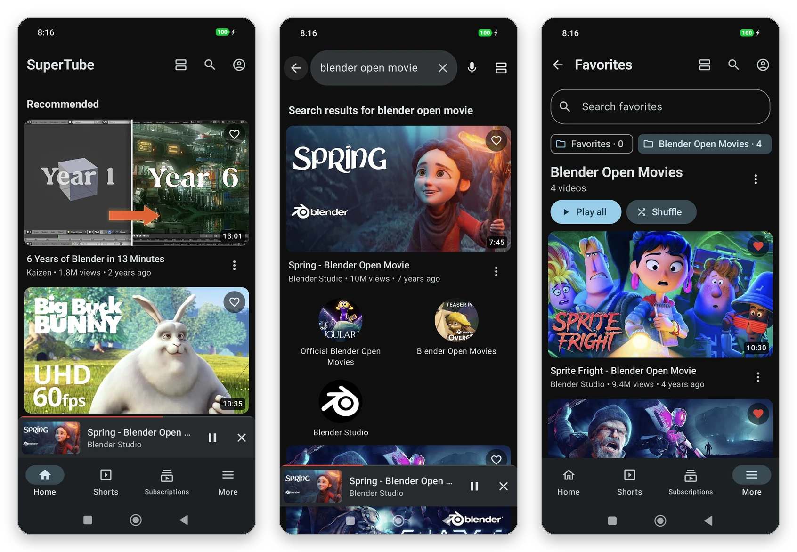
</p>

<p align="center">
  <a href="#features">Features</a> ·
  <a href="#download">Download</a> ·
  <a href="#building">Building</a> ·
  <a href="#architecture">Architecture</a> ·
  <a href="CHANGELOG.md">Changelog</a> ·
  <a href="#en-español">Español</a>
</p>

## Why SuperTube?

[SmartTube](https://github.com/yuliskov/SmartTube) is an excellent YouTube client, but it is built for TV remotes: a
fixed 1080p "10-foot" interface, D-pad focus navigation and Leanback screens. On a phone it looks tiny and is awkward to
use with your fingers.

**SuperTube keeps SmartTube's engine** — no ads, SponsorBlock, DeArrow, accounts, history, playlists, quality and codec
selection — and **replaces the whole interface** with one designed for touch screens, following the
[Android adaptive design guidelines](https://developer.android.com/develop/ui/compose/layouts/adaptive).

## Features

### A real mobile interface

Jetpack Compose and Material 3 with light and dark themes and dynamic colors. Navigation adapts to the window: a bottom
bar on phones and a navigation rail in landscape, on tablets and on foldables. Videos can be shown as a **list**, a
**compact list**, a **grid** or **horizontal shelves**, and the choice is remembered.

<p align="center">
  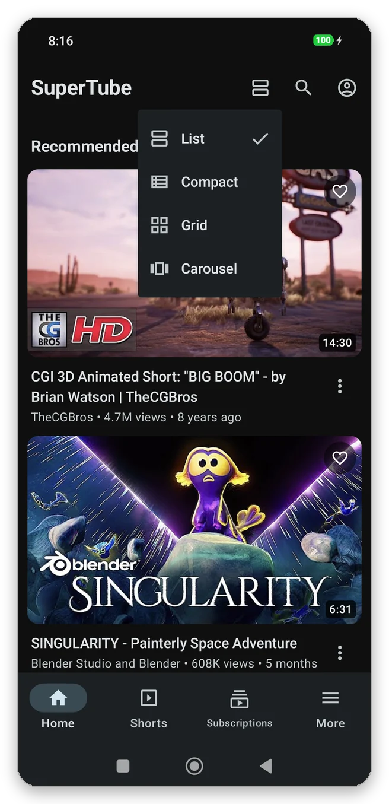
  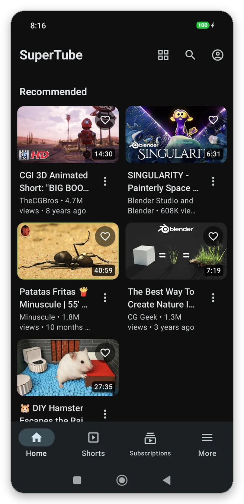
</p>
<p align="center">
  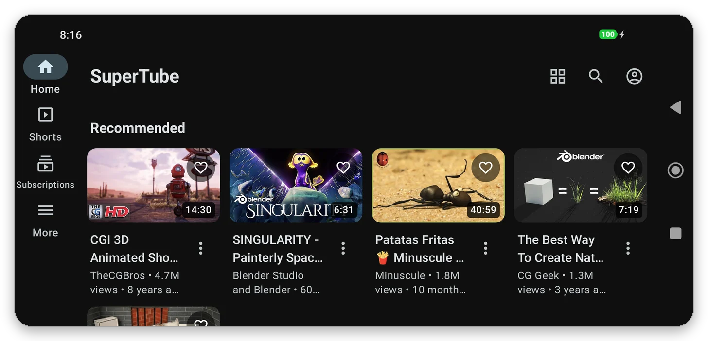
</p>

### Touch player

| Gesture or control | Action |
| --- | --- |
| Double tap left / right | Seek −10 / +10 s (consecutive taps add up) |
| Press and hold | Temporary 2× speed |
| Speed button | 1× → 1.5× → 2×; long press for the full list |
| Swipe up / down | Fullscreen / collapse into the mini player (vertical videos stay in portrait) |
| Swipe in fullscreen | Brightness (left side) and volume (right side) |

The seek bar shows the **SponsorBlock** segments. Back or a swipe down collapses the video into a **mini player** that
keeps playing while you browse. Leaving the app keeps the video in **picture-in-picture**, and audio keeps playing with
the screen off, with **lock screen and notification controls**. There is also a **sleep timer**, and playback pauses
when headphones are unplugged.

<p align="center">
  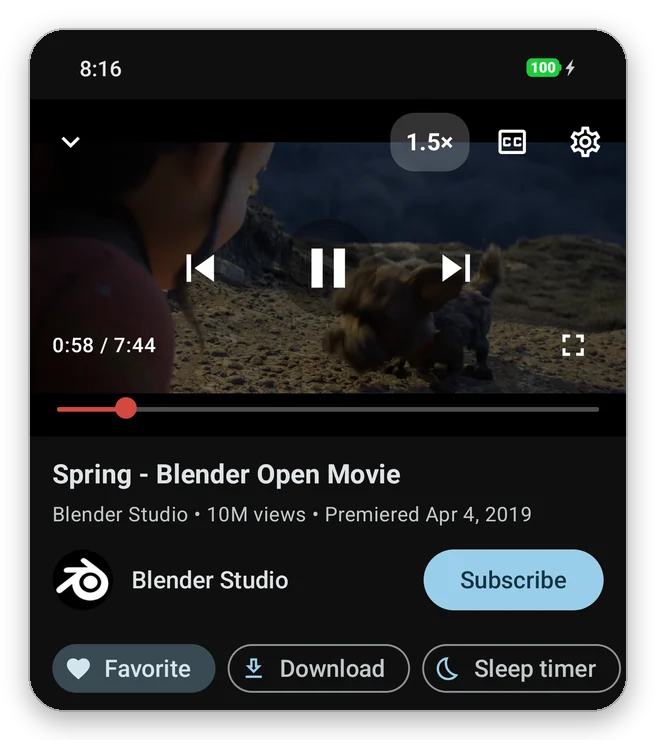
  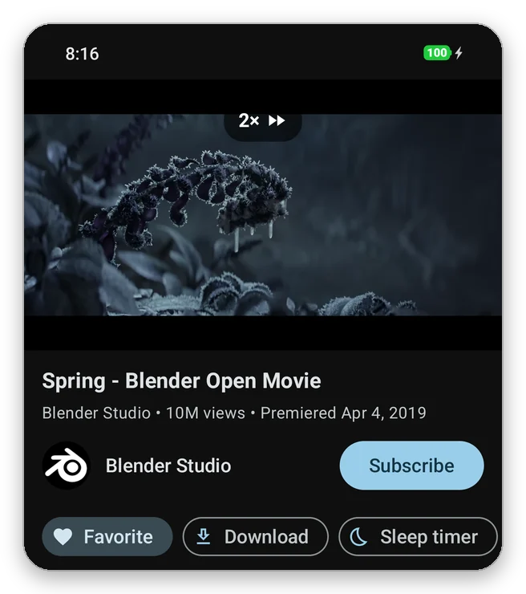
</p>
<p align="center">
  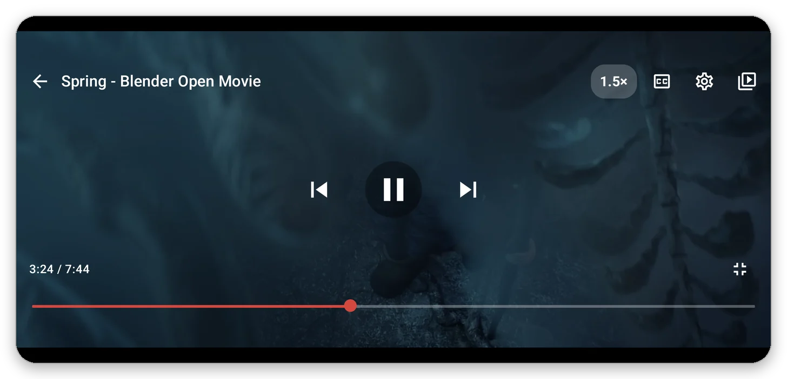
</p>
<p align="center">
  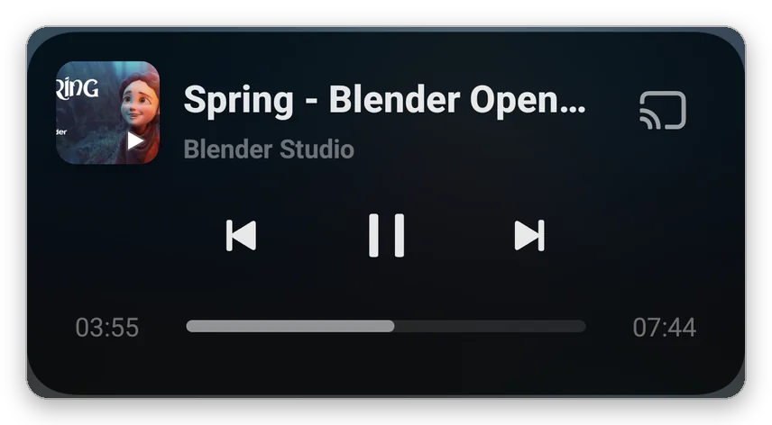
</p>

### Favorites with folders

The ♡ on every video saves it to *Favorites* or to your own folders. Folders can be searched, renamed and played in
order or shuffled. A **home screen widget** shows them, and everything can be **exported and imported** as a JSON file.
Favorites are stored only on your device.

<p align="center">
  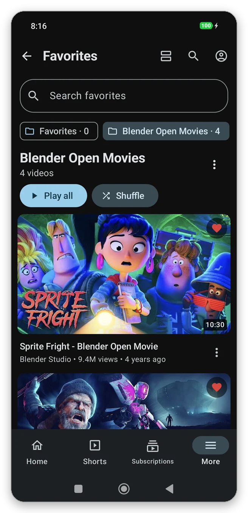
  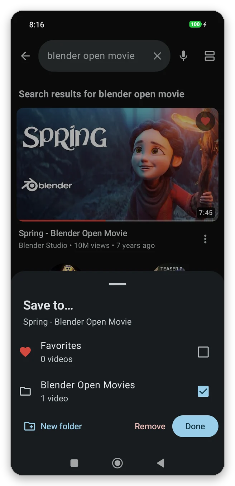
  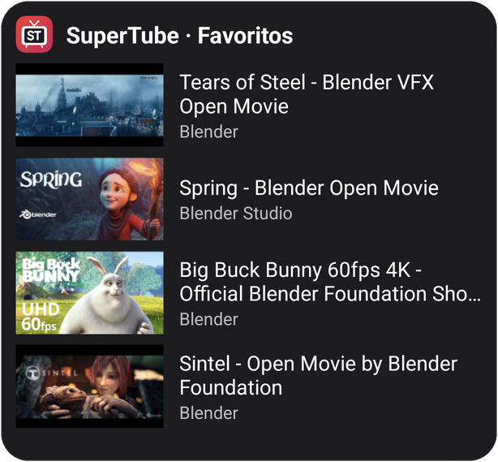
</p>

### Downloads manager

Download the **audio** or the **video** (up to 1080p H.264, joined on the device without re-encoding) after choosing the
quality and seeing its size. Downloads can be **paused and resumed**, even after closing the app; expired links are
refreshed automatically. Optional **Wi‑Fi only** mode, video and audio filters, an offline player, and files saved to
`Movies/SuperTube` and `Music/SuperTube`.

<p align="center">
  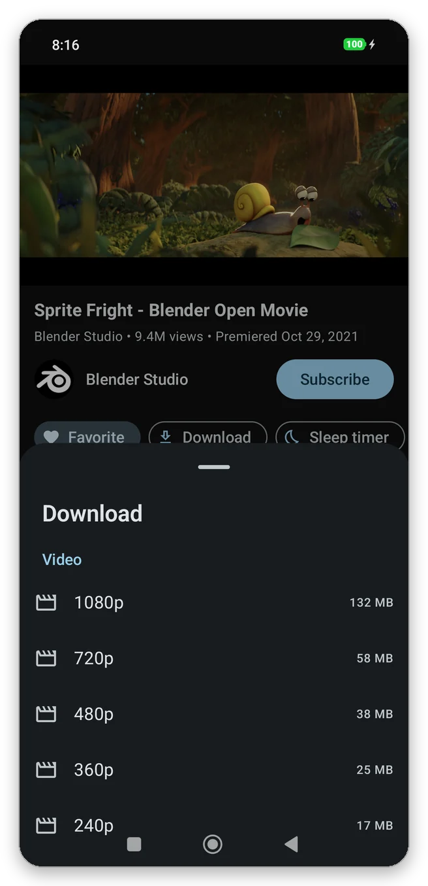
  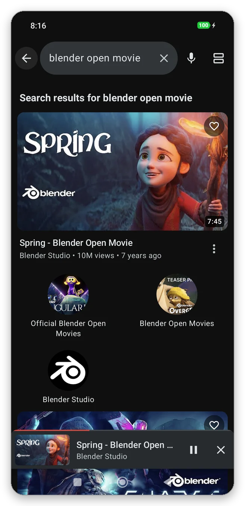
</p>

> Without a YouTube account, YouTube only offers single-file streams (usually 360p); sign in for up to 1080p.

### Also included

- **Search** with local recent searches, voice search and filters.
- **Reorderable sections** in *More*, settings as bottom sheets, and TV-only settings hidden.
- **Updates** from the releases of this repository (*Settings › SuperTube › Check for updates*).
- **20 languages**, selectable per app in the Android 13+ system settings.
- Everything from SmartTube: no ads, SponsorBlock, DeArrow, sign-in (subscriptions, history, playlists), 4K/8K, HDR,
  60 fps, codec selection, subtitles, live chat and comments.

## Download

Get the APK from the **[latest release](https://github.com/jgestal/SuperTube/releases/latest)**. Later versions can be
installed from *Settings › SuperTube › Check for updates*.

- Requires **Android 8.0** or newer (ARM 32/64-bit); ready for devices with 16 KB memory pages.
- SuperTube is a separate app (`app.supertube`) and can be installed next to SmartTube.
- Release signing certificate (SHA-256):
  `f6:fb:28:69:7f:24:d1:bf:21:ff:12:b8:20:e2:64:ca:4a:94:2f:3e:e8:4c:75:f2:01:6d:eb:3c:e6:07:70:41`

SuperTube is distributed only through GitHub, so it doesn't include Google Play Services features such as Chromecast or
Android Auto. See the [changelog](CHANGELOG.md) for what changed in each version.

## Building

```bash
git clone --recurse-submodules https://github.com/jgestal/SuperTube.git
cd SuperTube
# Gradle 7.5 runs on JDK 11-17
JAVA_HOME=/path/to/jdk-17 ./gradlew :supertube:assembleStbetaDebug
```

The APK is generated in `supertube/build/outputs/apk/stbeta/debug/`. For signed release builds, create
`supertube/keystore.properties` (`storeFile`, `storePassword`, `keyAlias`, `keyPassword`) and run
`./gradlew :supertube:assembleStbetaRelease`.

Checks before a release:

```bash
./gradlew :supertube:testStbetaDebugUnitTest :supertube:lintStbetaDebug   # unit tests and lint
supertube/tools/rotation_e2e.sh path/to/SuperTube.apk                      # fullscreen and rotation, on an emulator
```

## Architecture

SuperTube reuses SmartTube's MVP architecture: every presenter in the `common` module talks to a `View` interface
(`BrowseView`, `PlaybackView`, `SearchView`, `AppDialogView`…). The TV app implements those views with Leanback
fragments; **SuperTube implements them with Compose activities**, so the business logic is shared unchanged.

| Module | Description |
| --- | --- |
| `supertube` | The mobile app: Compose UI, playback service, favorites, downloads, widget, updater |
| `common` | SmartTube business logic: presenters, player engine (ExoPlayer), settings |
| `smarttubetv` | Original SmartTube TV app, kept to make merging upstream changes easy |
| `MediaServiceCore`, `SharedModules` | SmartTube submodules (YouTube API, utilities) |

Notable mobile-only pieces in `supertube/src/main/java/.../mobile/`:

| Path | Purpose |
| --- | --- |
| `ui/playback/` | Player screen, controls, gestures and mini player |
| `playback/` | Media session, notification and `mediaPlayback` foreground service |
| `ui/feed/` | Feed layouts shared by every screen |
| `download/` | Resumable downloads, track joining and Wi‑Fi only mode |
| `prefs/`, `widget/`, `update/` | Favorites and settings, home screen widget, updater |

## Downloads notice

Downloading content may be against YouTube's Terms of Service. The download feature is provided for **personal use** of
content you have the right to save (for example the Creative Commons Blender open movies shown above). Do not
redistribute copyrighted content.

## Credits and license

SuperTube is based on **[SmartTube](https://github.com/yuliskov/SmartTube)** by **yuliskov** and its modules
[MediaServiceCore](https://github.com/yuliskov/MediaServiceCore) and [SharedModules](https://github.com/yuliskov/SharedModules),
released under the MIT License. All the credit for the YouTube engine and the original features goes to them. The
original README is kept in [README_SmartTube.md](README_SmartTube.md).

SuperTube is released under the [MIT License](LICENSE). ExoPlayer (`exoplayer-amzn-2.10.6`) is licensed under Apache 2.0.
Screenshots show Creative Commons films by the Blender Foundation, without a signed-in account.

SuperTube is not affiliated with, endorsed by or connected to YouTube, Google or the SmartTube project.

---

## En español

**SuperTube** es un cliente de YouTube sin anuncios para móviles y tablets Android, basado en SmartTube (diseñado para
TV). Mantiene todo su motor y sustituye la interfaz por una táctil con Material 3:

- **Navegación adaptativa**: barra inferior o lateral, y cuatro vistas de vídeos (lista, compacta, cuadrícula y carrusel).
- **Reproductor táctil**:
  - Doble toque para avanzar o retroceder, mantener pulsado para 2× y **botón de velocidad** (1× · 1,5× · 2×).
  - Gestos de brillo y volumen, **mini reproductor**, imagen en imagen y **temporizador de apagado**.
  - Reproducción en segundo plano con **controles en la pantalla de bloqueo** y en las notificaciones.
- **Favoritos con carpetas**, búsqueda, reproducción continua o aleatoria, **widget** y exportación/importación.
- **Gestor de descargas** de audio y vídeo con selector de calidad, modo solo Wi‑Fi y pausa/reanudación.
- **20 idiomas** y actualizaciones desde este repositorio.

Descarga la última versión en la [página de Releases](https://github.com/jgestal/SuperTube/releases/latest)
(requiere Android 8.0 o superior). Los cambios de cada versión están en el [CHANGELOG](CHANGELOG.md).
